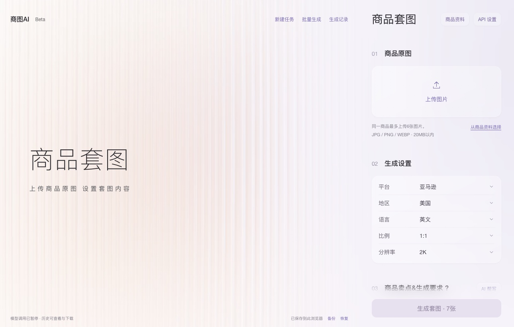
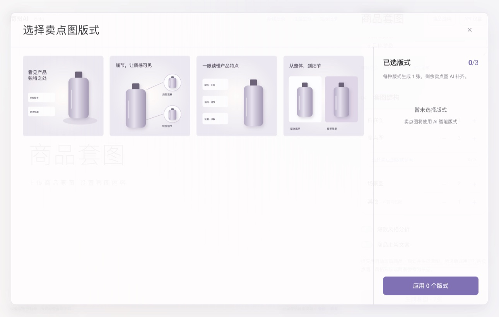
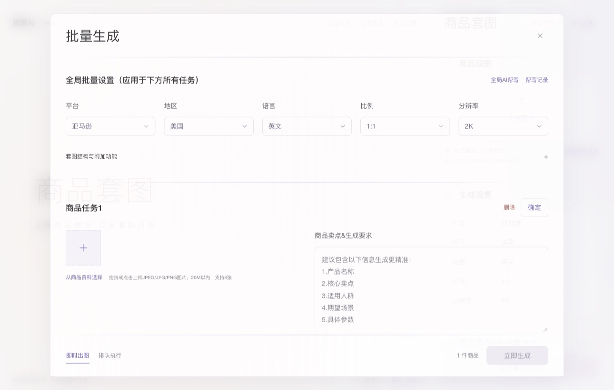

# 商图AI

商图AI是一款面向电商卖家的 AI 商品套图工具。制作一套上架图片时，可以先规划每张图负责展示什么，再生成白底图、卖点图和场景图。同一件商品可上传多张参考图，帮助模型识别商品外观与细节。

## 商品套图

1. 上传商品原图，填写卖点和生成要求。
2. 选择目标平台、地区、语言、画幅和分辨率，设置各类图片的数量。
3. 查看套图规划，确认后生成。结果可逐张预览、修改，也可以整套打包下载。

项目处于本地 Beta 阶段。单商品套图已跑通过真实模型生成、修改和下载流程。多商品批量任务界面已实现，批量真实生成仍在验证中。







## 本地运行

使用 Node.js 22.18 或更新版本。在仓库根目录运行：

```sh
npm start
```

打开 [本地工作台](http://127.0.0.1:5178/)。可通过 `PORT` 环境变量指定其他端口。

使用真实生成时，在工作台的 **API 设置** 中配置已适配的文字和图像模型，并分别测试连接。服务端配置示例位于 [config.example.json](backend/integration/config.example.json)，默认暂停真实模型调用。文字规划和图像生成会消耗模型服务配额。

前端使用 JavaScript、HTML 和 CSS，后端使用 Node.js 与 SQLite。部分本地图像合成和 OCR 功能使用 macOS 的 Swift 工具。

```sh
npm run check
npm test
```
